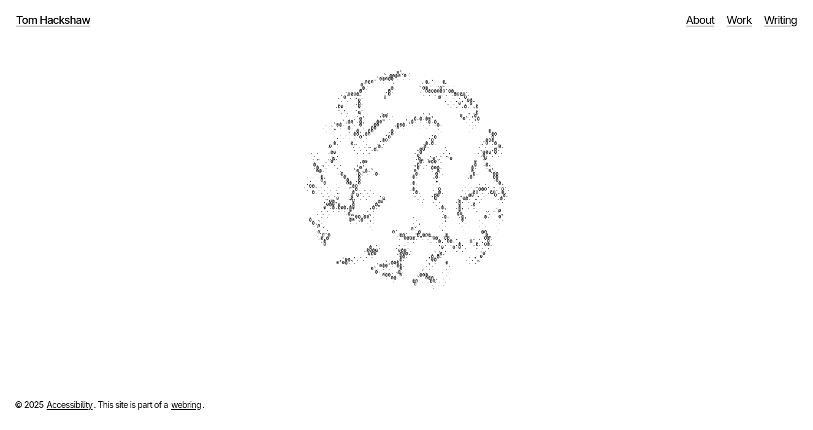

# wwwtom



A monorepo for [tom.so](https://tom.so), [sophie.st](https://sophie.st), and the services behind them.

This is still a work in progress and has some rough edges. I use it to explore different technologies and patterns, mostly for my own enjoyment.

## Layout

- `apps/web` — tom.so: Solid 2 + Vite on Workers. Posts and works read are.na master channels through the adapter.
- `apps/sophie` — sophie.st: Solid 2 SSR blog on the Camus CMS.
- `apps/editor` — Camus: the Tiptap editor SPA. It serves Sophie. Tom's instance is retired.
- `apps/api` — Elysia + Effect Worker for both tenants (`TENANT=tom|sophie`).
- `apps/adapter` — Elysia + Effect BFF Worker: are.na, auth, CMS, guestbook, GitHub, image, and OG.
- `apps/simulator` — fixture upstreams for the e2e suite.
- `apps/e2e` — Playwright suites.
- `packages/*` — shared `ui`, `schemas`, `utils`, `arena`, `db`, `icons`, `constants`, `types`, and `workflows`.
- `infra` — Alchemy stacks: shared, turbo, api, adapter, web, sophie, and preview.

External packages and dependencies have been deliberately kept small in order to keep the project lean.

## Content

tom.so is read-only. Posts and works are are.na master channels. The site reads them through the adapter with `@tom/arena/content`, and the types live in `@tom/schemas/arena-content` as Effect Schemas.

[sophie.st](https://sophie.st) uses Camus: a slim CMS on D1 plus R2. It has its own editor instance, Google-only sign-in, and posts-only content. The API and adapter workers serve both tenants (`TENANT=tom|sophie`); the editor build switches tenant with `VITE_SOPHIE`/`VITE_AUTH_PROVIDER`.

## Developing

```bash
pnpm dev # Start every app via Turbo
pnpm dev:web # tom.so
pnpm dev:sophie # sophie.st
pnpm dev:editor # Camus editor
pnpm dev:api # API worker
pnpm dev:adapter # Adapter worker
pnpm build # Production build
pnpm typecheck # TypeScript
pnpm lint # Run oxlint
pnpm test # Run Vitest via Turbo
pnpm format # Check formatting with oxfmt
pnpm write # Format files with oxfmt
```

## Previews

Every PR against `dev` gets preview deploys for tom.so and sophie.st. The preview stack posts one PR comment with both links. Preview stages use `ALCHEMY_STAGE=pr-<number>`.

Sophie's editor preview authenticates through the dev adapter. OAuth redirect URIs are exact-match, so per-PR hosts cannot be registered.

## Deployment

The main site is cheap and bare bones. It uses [Cloudflare Workers](https://workers.cloudflare.com) and [Alchemy](https://alchemy.run) to build and deploy. Static media assets such as images live on a separate CDN to keep the site light and fast.

Alchemy deploys in dependency order: shared, turbo, api, adapter, web, then sophie. `pnpm deploy` runs the chain plus the zone edge rules, and `ALCHEMY_STAGE` is required. Production deploys are manual. Every push to `dev` deploys the `staging` stage.

This project uses many Cloudflare services: Workers, Wrangler, KV, D1, R2, and Hyperdrive. That makes it less portable than it could be. Alchemy keeps the provider surface in `infra`, so a move to another provider such as AWS should stay contained.

## Testing

Unit tests run under Vitest in each workspace (`pnpm test` via Turbo).

End to end tests run under Playwright in `apps/e2e`, in three projects:

- **Fixture suite** (`tests/`): every page against a fully local stack. The simulator (`apps/simulator`) stands in for the real upstreams (are.na, the CMS API, D1, the internal API) through an `x-use-simulator` header, so the suite is deterministic. It runs on every PR against `dev` and nightly.
- **Editor suite** (`tests/editor.spec.ts`): the Camus editor with every adapter call intercepted. GitHub OAuth cannot run headless, so the suite supplies fixture sessions and content.
- **Staging suite** (`tests-staging/`): content-agnostic smoke checks against the deployed `staging` stage (`staging-web.tom.so`) with real upstreams. It runs manually. There is no scheduled workflow, because Cloudflare bot protection blocks GitHub runner IPs.

```bash
pnpm --filter @tom/e2e test:e2e # Fixture suite (local stack)
pnpm --filter @tom/e2e test:e2e:editor # Editor suite
pnpm --filter @tom/e2e test:e2e:staging # Staging suite (deployed stage)
```

See `apps/e2e/README.md` for the full setup, conventions, and known gaps.

## License

This is free software under the GPL. However, I kindly ask that you do not repost my work/images without permission or present this as your own.
